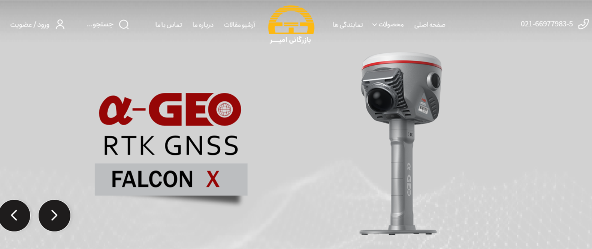
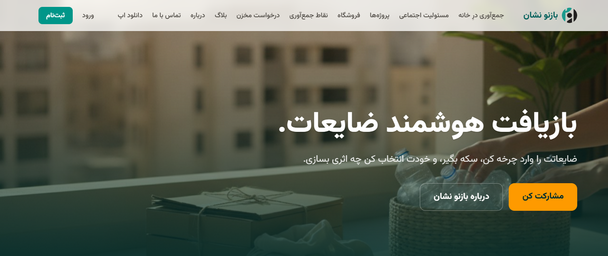
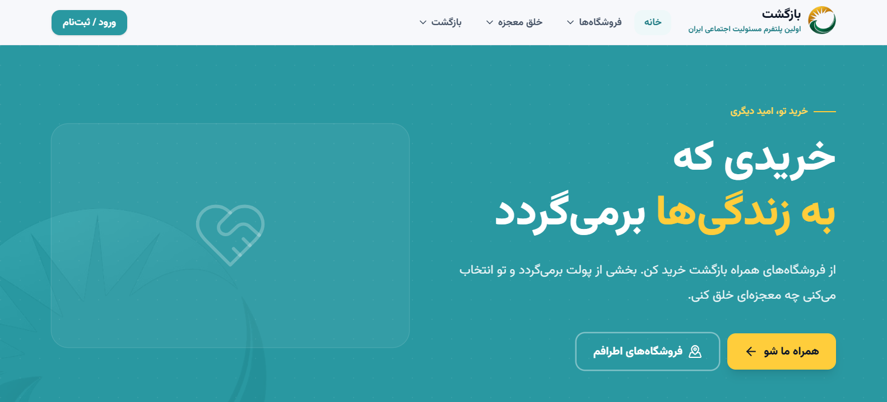
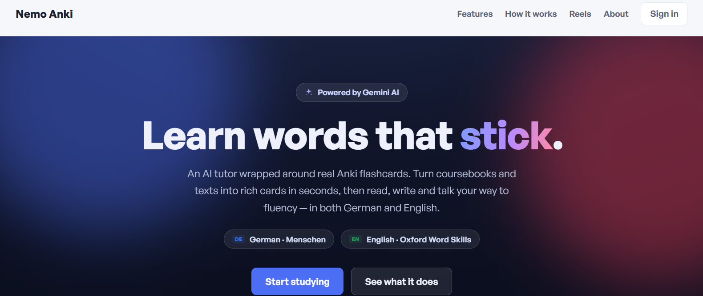

 

## About Me

A full-stack developer who ships complete products, not demos — from UI design and backend architecture to data modeling, AI integration, and deployment on real infrastructure.

My latest build is a full digital planner: an installable PWA, an AI assistant that actually knows the user's real schedule and reasons about it, real server-sent push reminders, and a dedicated admin panel — all running on real production infrastructure (Postgres + Vercel) with a real user.

I'm also a core contributor on a team building two live social-impact platforms — **Bazno** and **Bazgasht** — with React, Django, PostgreSQL, and Expo mobile apps.

On the WordPress side, I develop and run technical SEO for a live WooCommerce store — from Search Console analysis and indexing fixes to structured data and site performance.

## Tech Stack

## Featured Projects

<table width="100%">
<tr>
<td width="50%" valign="top">

### 📓 [Planner](https://github.com/ameneyazdian101/planner)

A personal digital planner with a full Persian (Jalali) calendar — daily/weekly/monthly planning, goals, habit tracking, journaling, and an AI assistant that reasons about the user's real schedule. Full PWA with real server-pushed reminders.

`Next.js` `TypeScript` `Prisma` `PostgreSQL` `Gemini AI`

**[Live demo ↗](https://planner-vmdv-eight.vercel.app)**

</td>
<td width="50%" valign="top">

### 🛒 [Amir Trading](https://amir-trading.com)

A live WooCommerce store for surveying equipment (total stations, GNSS receivers, laser scanners). I develop and maintain the site and run its **technical SEO**: site audits, Search Console analysis, fixing unindexed category pages, resolving keyword cannibalization, VideoObject structured data for embedded product videos, and performance and caching checks.

`WordPress` `WooCommerce` `PHP` `Technical SEO` `Search Console` `Schema.org`

**[Live site ↗](https://amir-trading.com)**

</td>
</tr>
<tr>
<td width="50%" valign="top">

### ♻️ [Bazno](https://baznoneshan.ir)

An environmental & social participation platform: users send household waste into recycling, earn participation coins, and spend them on social causes, discount codes, or a coin-only shop. Includes collection points, wallet, referrals, a separate collector app, and a native Android app published on Cafe Bazaar.

`React` `TypeScript` `Django REST` `PostgreSQL` `Expo / React Native`

**[Live site ↗](https://baznoneshan.ir)** · **[Android app ↗](https://cafebazaar.ir/app/com.baznoneshan.app)** · _team project (private repo)_

</td>
<td width="50%" valign="top">

### 💚 [Bazgasht](https://bazgashtapp.ir)

Smart shopping with social impact: users buy at ~5,800 partner stores, a share of every purchase returns to their wallet as cashback, and they choose which charity project or campaign it funds. Store map, QR/receipt/bank-card purchase tracking, merchant panel, and a full admin panel.

`React` `TypeScript` `Django REST` `PostgreSQL` `Expo / React Native`

**[Live site ↗](https://bazgashtapp.ir)** · _team project (private repo)_

</td>
</tr>
<tr>
<td width="50%" valign="top">

### 🧠 [Nemo Anki](https://anki.nemoapps.xyz)

An AI language tutor built around real Anki-style spaced repetition for German and English. Gemini turns pasted coursebook pages into vocab, sentence, and grammar cards, with background jobs, push reminders, and a Telegram bot.

`React` `TypeScript` `Django REST` `PostgreSQL` `Redis / Celery` `Gemini AI`

**[Live site ↗](https://anki.nemoapps.xyz)** · _private repo_

</td>
<td width="50%" valign="top"></td>
</tr>
</table>

## Get in Touch

